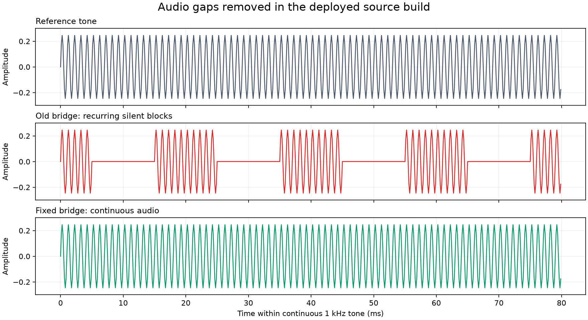

# Reproducible Linux build and audio regression

This build compiles PJSIP 2.15.1 with its standard configure/make system and
links the application against the resulting headers and libraries. It builds
natively on Linux ARM64 (including Raspberry Pi) and AMD64. Docker is required.
It does not use the repository's checked-in binaries or the manually enumerated
object lists in the older cross-compilation scripts.

```sh
docker build -f docker/linux/Dockerfile --target runtime -t sipserver:source .
```

The PJSIP archive is pinned by SHA-256. The runtime includes OpenSSL and the AMR
shared libraries; Python, FFmpeg, and the compiler are excluded. Existing `.env`
configuration can be passed with `--env-file`:

```sh
docker run --rm --name sipserver --network host --env-file .env \
  --read-only --cap-drop ALL --security-opt no-new-privileges:true \
  --tmpfs /tmp:rw,noexec,nosuid,size=16m sipserver:source
```

This uses Linux host networking for SIP/RTP. Use your existing LAN firewall
rules and provisioning configuration. The runtime runs as UID/GID 65532;
provision credentials before starting this headless, read-only deployment.

## Frame handling

G.711 has a 10 ms base codec frame, while AMR has a 20 ms frame. Setting
`frm_per_pkt = 1` for every codec does not mean every packet contains 20 ms of
audio. `set_codecs()` now derives aggregation from each codec's frame duration:
two G.711 frames or one AMR frame per 20 ms packet. VAD/CNG remain disabled in
the bridge, and AMR's octet alignment and mode negotiation are retained.

The Linux build also retains `PJSIP_MAX_URL_SIZE=2048` for Jio's long Contact
parameters, disables the unused sound-device echo canceller, and uses a portable
sleep in the audio-meter thread.

## Network-isolated audio test

```sh
docker build -f docker/linux/Dockerfile --target test -t sipserver-audio-test .
sh tests/audio/run.sh
```

The test runs a synthetic TLS SIP carrier and UDP softphone on loopback inside
a container with `--network none`. It supplies synthetic credentials and cannot
place a real Jio call. Captures and measurements go into ignored `test-results/`.

Seven cases exercise PCMA → PCMA, PCMA → AMR, and PCMU → AMR with 10/20 ms
input packets and 10/20 ms SDP packet times. The source contains silence, a
continuous 1 kHz tone, multitone audio, and voiced harmonics. An optional mono
8 kHz signed-16-bit `test-results/reference-speech.wav` adds speech. FFmpeg
independently encodes the G.711 input and decodes the RTP capture.

The verification rejects recurring 10 ms silent blocks in the sustained tone,
RTP sequence gaps, clipping, decoder errors, and malformed mode-7 AMR output.
The PCMA control must also retain >0.99 tone correlation after alignment.
The threshold detects the reproduced defect; this is not a perceptual MOS test
or a complete SIP/network interoperability suite.

## Reproduction and validation evidence

The v1.3.0 ARM64 release executable with SHA-256
`a8476e117bef6c7e51587e6ad02c7f319a025c5f536996dfad8fb6a1536735e8`
produced approximately 10 ms of silence every 20 ms, even in the PCMA → PCMA
control. The problem reproduced across all seven packet-time cases with no
captured RTP sequence gaps. AMR alone was not required to reproduce it.

A replacement built from the published v1.3.0 application source, standard
PJSIP, and these frame/AMR/Linux settings passed all seven checks on ARM64.
PCMA speech matched the reference exactly after alignment. AMR speech matched
direct OpenCORE encoding at approximately 0.995 correlation. A subsequent real
Linphone → Jio call confirmed that outgoing static was gone. Additional reverse
AMR → PCMA tests showed no recurring silent blocks, although jitter-buffer
delay changes made whole-signal correlation vary between runs.



These measurements validate the combined source-build replacement. The release
executable differs from published source, so they do not establish that changing
`frm_per_pkt` alone repairs that executable or identify its exact faulty
instruction. The committed regression allows maintainers to evaluate freshly
built candidates instead of relying on successful packet delivery alone.

The current-master application with these changes also passed all seven forward
cases on ARM64 using the committed verifier.

The existing release workflow and checked-in executables are unchanged by this
build path. Maintainers must adopt freshly built, verified artifacts when
publishing a subsequent release.

## Clarity and wideband limitations

The verified live call negotiated PCMU/8 kHz locally and AMR-NB/8 kHz upstream.
That remains narrowband audio even after the corruption is fixed. Higher
clarity requires a wideband codec on the client and carrier legs and a media
clock that preserves the wider bandwidth. This change does not claim to enable
or verify an end-to-end wideband path.
