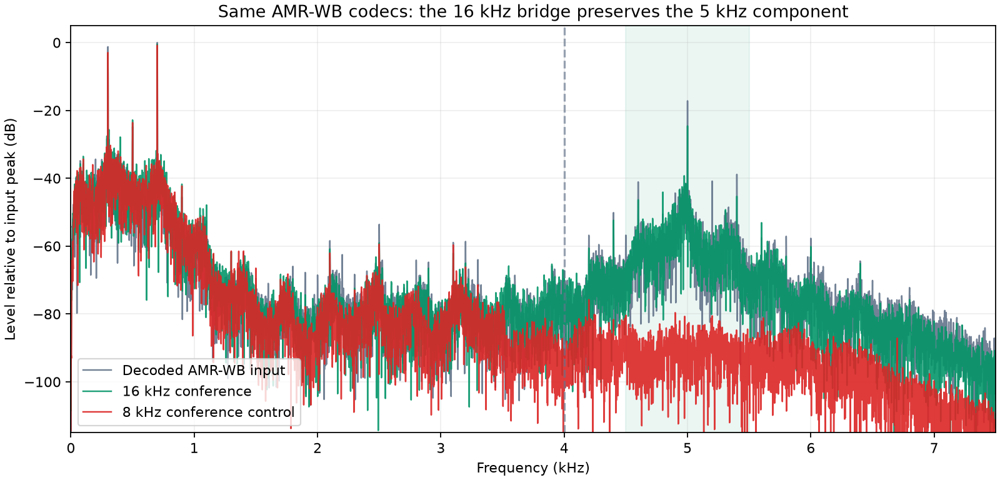

# Opt-in G.722 ↔ AMR-WB audio path

The Linux source Docker build includes G.722, a codec available in standard
Linphone builds. Set `ENABLE_WIDEBAND=1` to run the PCM conference bridge and
its null sound clock at 16 kHz and enable G.722 above the narrowband codecs.
AMR-WB remains the highest-priority codec. AMR-NB and PCMA/PCMU remain available
for calls where the client or carrier does not support wideband.

The default `ENABLE_WIDEBAND=0` retains the existing 8 kHz conference and disables
G.722 in codec selection. `true` and `on` also enable the option. Existing
checked-in release executables and older manually enumerated builds may not
contain G.722; use the source Docker build for this path.

## Configure

```sh
docker build -f docker/linux/Dockerfile --target runtime -t sipserver:wideband .
docker run --rm --name sipserver --network host --env-file .env \
  -e ENABLE_WIDEBAND=1 --read-only --cap-drop ALL \
  --security-opt no-new-privileges:true \
  --tmpfs /tmp:rw,noexec,nosuid,size=16m sipserver:wideband
```

Use already-provisioned credentials and the existing LAN firewall. Provisioning
is separate from this headless, read-only runtime.

In Linphone, enable **G.722** in Audio Codecs and put it above PCMA/PCMU. Keep
PCMA/PCMU enabled as fallbacks. AMR-WB support in Linphone depends on its build;
G.722 provides a wideband client path without requiring a custom AMR-WB plugin.

G.722 carries **16 kHz audio with an 8 kHz RTP clock**. `G722/8000` in SDP is
correct; a 20 ms packet advances its RTP timestamp by 160. AMR-WB uses a
16 kHz RTP clock and advances by 320. See
[RFC 3551 §4.5.2](https://www.rfc-editor.org/rfc/rfc3551.html#section-4.5.2) and
[Linphone codec availability](https://wiki.linphone.org/xwiki/wiki/public/view/Lib/Features/Codecs/).

## Verify the real call

The startup log must report `Conference media clock: 16000 Hz`. After a test
call, the media statistics must show G.722 at 16 kHz on the client leg and
AMR-WB at 16 kHz on the carrier leg. A call that negotiates AMR at 8 kHz upstream
still works, but it is narrowband even if the client leg uses G.722.

This option cannot force Jio, a remote carrier, or the called handset to accept
AMR-WB. It does not reconstruct high frequencies already removed by a narrowband
client or upstream call. Both codecs still pass through PCM decode/re-encode;
this is bandwidth preservation, not encoded-packet passthrough.

## Isolated regression

```sh
docker build -f docker/linux/Dockerfile --target test -t sipserver-audio-test .
sh tests/audio/run-wideband.sh

# Preserve narrowband compatibility with the option off and on.
AUDIO_RESULTS_DIR=test-results/narrowband-default sh tests/audio/run.sh
ENABLE_WIDEBAND=1 AUDIO_RESULTS_DIR=test-results/narrowband-16khz sh tests/audio/run.sh
```

All calls run against synthetic loopback SIP endpoints in `--network none`
containers. No Jio credentials or real calls are used. Results go under ignored
`test-results/` directories. Set `AUDIO_RESULTS_DIR` to choose another output
directory.

The wideband matrix covers G.722 → G.722, G.722 → AMR-WB, AMR-WB → G.722,
AMR-WB → AMR-WB, G.722 → AMR-NB carrier fallback, and PCMA → AMR-WB client fallback. It checks wire payload types,
codec-specific RTP timestamp rates, decoding, continuity, and 5 kHz energy above
the legacy path's bandwidth. High/low-band energy is compared to the decoded
source, allowing normal AMR-WB coding attenuation; wideband routes must retain
at least 10% of that ratio. Continuity checks also account for AMR-WB tone
envelope changes. The default 8 kHz narrowband guard from the static fix is unchanged. In 16 kHz
mode, narrowband AMR tone continuity is compared with an independent PJSIP
8→16→8 kHz converter plus direct OpenCORE encoder, with a 20% envelope margin
and a hard RMS ratio floor of 0.25. This permits normal coding modulation of a
pure tone while still rejecting the original near-silent blocks. AMR-WB test endpoints negotiate mode 2 (12.65 kbps),
not an unsupported assumption that the carrier accepts the highest bitrate.

An additional AMR-WB → AMR-WB control keeps the same wire codecs but disables
the 16 kHz bridge. Its 5 kHz energy must disappear, and the wideband bridge must
improve the high/low-band energy ratio by over 20 dB. Merely negotiating AMR-WB
is therefore insufficient to pass the test.

These synthetic checks do not measure MOS or establish live Jio AMR-WB support.
The already-working narrowband deployment should be retained until a real
wideband call confirms both negotiated codecs and subjective audio quality.

## ARM64 measurement evidence

The source-built runtime passed the six route cases plus the 8 kHz negative
control. With the same AMR-WB source and output codec, the 16 kHz conference
improved normalized 4.5–5.5 kHz / 0.2–1.5 kHz energy retention by **38.6 dB**
relative to the 8 kHz conference. This is a bandwidth measurement of a synthetic
signal, not a claim of a 38.6 dB improvement in perceived call quality.



[Route and negative-control measurements](wideband-measurements.json) accompany
the plot. The narrowband source case has no high-band retention value because
its input does not contain frequencies above 4 kHz.

The seven-case narrowband suite passed with the option both off and on. In the
16 kHz PCMU → AMR case, a pure-tone RMS ratio of 0.419 was compared with 0.496
from the independent converter/encoder, yielding a 0.397 guard. The original
broken AMR capture measured 0.059 and remains rejected. No production codec
behavior is changed to tune these test-only envelope thresholds.
